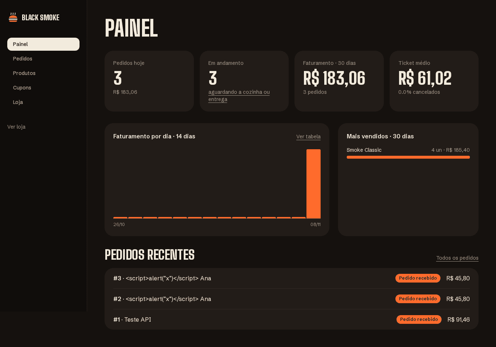
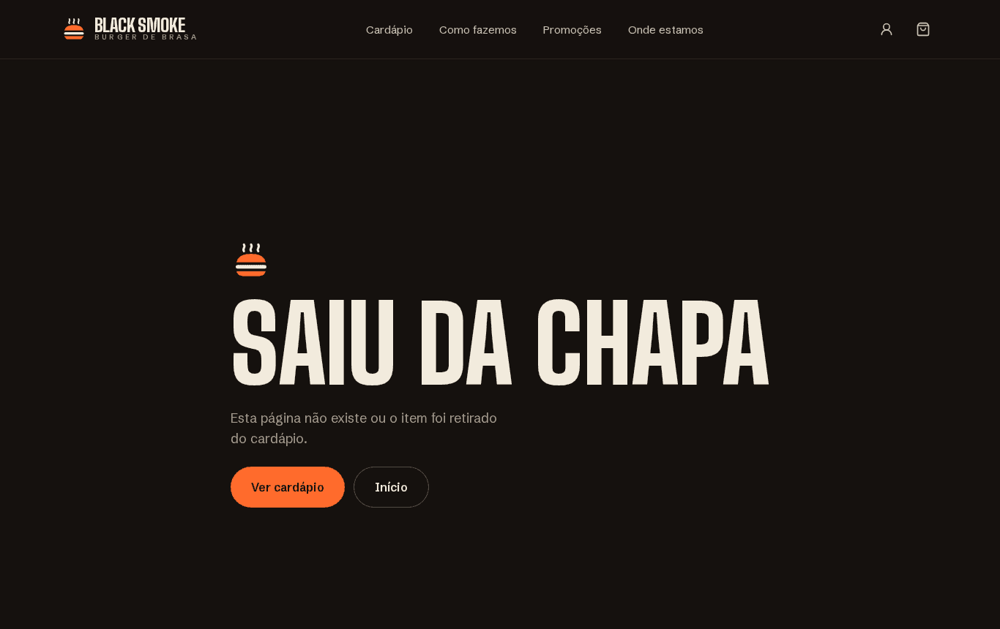
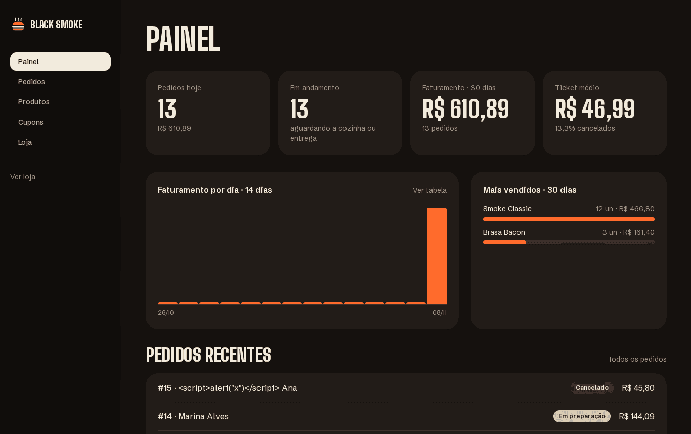

# Testes exploratórios assistidos — Black Smoke Burger

| | |
|---|---|
| **Data** | 2026-11-08 |
| **Versão testada** | build de produção (`.next/standalone`) de 2026-11-08 21:19, sem alterações de código depois |
| **Ambiente** | Linux, Chromium headless (Playwright 1.65), PostgreSQL 17 embarcado, banco `blacksmoke` semeado, Mercado Pago **não** configurado |
| **Técnica** | Session-Based Test Management (SBTM): 8 sessões com charter, heurísticas SFDPOT, valores-limite, entradas hostis e manipulação de cliente |
| **Ferramentas** | skill `webapp-testing` (Anthropic) com scripts Python Playwright; Playwright MCP configurado em `.mcp.json` |
| **Resultado** | 114 observações + rodada cross-browser · **6 bugs (todos corrigidos)** · **7 melhorias (todas aplicadas)** · **3 dúvidas de produto (decididas)** · nenhum defeito de segurança ou de cálculo financeiro |

## 1. Como o teste foi conduzido

"Teste assistido" significa que um agente dirigiu o navegador e o testador humano decidiu. Para cada
sessão, o agente executou as sondagens do charter, tirou screenshots e registrou o que observou.
Depois, cada observação suspeita foi **reproduzida isoladamente** e só então classificada. Sete
observações que pareciam defeitos eram, na verdade, erros do próprio roteiro (ver §6).

1. **Reconhecimento** (padrão *reconnaissance-then-action* da skill `webapp-testing`): visita a todas
   as rotas (anônimo e admin), inventário de botões, campos e links, console e screenshot de página
   inteira. Scripts: [`tests/exploratory/recon.py`](../../tests/exploratory/recon.py) e
   [`recon_admin.py`](../../tests/exploratory/recon_admin.py). Screenshots `recon_*`.
2. **Sessões com charter**: [`tests/exploratory/explore.py`](../../tests/exploratory/explore.py). Cada
   observação vai para [`exploratory/session-log.json`](exploratory/session-log.json), com flag
   `BUG` / `MELHORIA` / `DÚVIDA` ou sem flag (conforme).
3. **Triagem**: reprodução manual de cada flag, leitura do código e da documentação do Next 16 para
   achar a causa raiz.
4. **Automação**: o que foi confirmado virou teste Playwright ([AUTOMATION.md](AUTOMATION.md)).

### Reproduzir

```bash
pnpm db:start                                    # Postgres local
pnpm build                                       # ou use pnpm dev (bem mais lento nesta máquina)
TRUST_PROXY=true NODE_ENV=production PORT=3000 node .next/standalone/server.js   # com as variáveis do .env
python3 tests/exploratory/recon.py http://localhost:3000
python3 tests/exploratory/explore.py http://localhost:3000          # todas as sessões
python3 tests/exploratory/explore.py http://localhost:3000 S4 S6    # só algumas
node scripts/compress-qa-screenshots.mjs
```

> `TRUST_PROXY=true` permite que cada contexto de navegador use um `X-Forwarded-For` próprio, isolando
> os rate limits entre sessões, como já faz a suíte E2E. Sem isso, a sessão S5 (força bruta no login)
> bloqueia o login do admin na S6 por 1 minuto. O script **cria pedidos, cupons e usuários**: nunca
> aponte para produção.

### Playwright MCP

O servidor MCP oficial do Playwright está em [`.mcp.json`](../../.mcp.json) (`@playwright/mcp@0.0.84`,
Chromium headless, artefatos em `test-results/mcp`). Ele expõe o navegador como ferramentas
(`browser_navigate`, `browser_snapshot`, `browser_click`, `browser_take_screenshot`…) para que o agente
explore **interativamente**, lendo a árvore de acessibilidade em vez de pixels. As ferramentas aparecem
depois de reiniciar o Claude Code e aprovar o servidor do projeto. Nesta rodada a exploração foi feita
com a skill (scripts), porque o MCP só carrega numa sessão nova. Para a próxima rodada: abra o Claude
Code no projeto, aprove `playwright` e peça, por exemplo, *"use o Playwright MCP para explorar o
checkout com CEP inválido"*.

## 2. Charters e cobertura

| Sessão | Charter: explorar… | com… | para descobrir… | Obs. | Flags |
|---|---|---|---|---|---|
| S1 | catálogo e busca | caixa, acentos, espaços, HTML, SQL, combinações de filtro, ordenação, rotas inexistentes | se a busca é robusta e os estados vazios são claros | 23 | 4 |
| S2 | produto e personalização | limites de quantidade e adicionais, observação longa, HTML, emoji, reload | se os limites do cliente são consistentes | 9 | 0 |
| S3 | carrinho e cupom | cupom abaixo do mínimo, caixa e espaços, remover itens com cupom aplicado, **adulterar preço no localStorage** | se o valor cobrado pode ser manipulado | 10 | 1 |
| S4 | checkout e acompanhamento | formulário vazio e inválido, máscara de telefone, retirada × entrega, **duplo clique**, XSS no nome, cancelamento, tokens inválidos, ID sequencial | se o pedido é criado uma única vez e o acompanhamento é privado | 15 | 2 |
| S5 | autenticação e acesso | cadastro inválido e duplicado, senha errada, e-mail inexistente, **12 logins seguidos**, cliente em `/admin` | enumeração de usuários, força bruta e escalada de privilégio | 11 | 0 |
| S6 | painel admin | preço negativo e gigante, slug `../../etc/passwd`, cupom de 150 %, datas invertidas, código duplicado, pausar a loja | se o admin aceita dados que quebram a loja | 17 | 1 |
| S7 | mobile, teclado e movimento | Pixel 7 (412 px), menu mobile, barra do carrinho, alvos de toque, ordem do Tab, `prefers-reduced-motion` | barreiras de uso e acessibilidade | 12 | 1 |
| S8 | API REST | quantidades 0, −1, 1000, 1,5; produto inexistente; `totalCents` forjado; JSON malformado; Origin de outro site; webhook sem assinatura; path traversal; headers | se a API confia no cliente | 17 | 0 |

## 3. Defeitos (bugs)

Severidade: **Alta** = perda financeira, de dados ou de segurança · **Média** = fluxo principal
prejudicado · **Baixa** = cosmético, SEO ou caso raro.

### BUG-01 · Dashboard escreve "1 pedidos" — Baixa · ✅ Corrigido

> **Correção:** helper `plural()` em [src/lib/format.ts](../../src/lib/format.ts) (regra explícita: `Intl.PluralRules("pt-BR")` classifica 0 como singular, "0 pedido"), usado no card e no gráfico. Teste unitário em `tests/unit/misc.test.ts` e verificação no E2E do dashboard.

- **Onde**: `/admin`, card "Faturamento · 30 dias", e tooltip/`aria-label` do gráfico diário.
- **Passos**: banco com exatamente 1 pedido nos últimos 30 dias → abrir `/admin`.
- **Esperado**: "1 pedido". **Obtido**: "1 pedidos" (o leitor de tela também lê "1 pedidos").
- **Causa**: string fixa `` `${d.orders} pedidos` `` em [src/app/admin/page.tsx:15](../../src/app/admin/page.tsx#L15),
  [src/components/admin/revenue-chart.tsx:40](../../src/components/admin/revenue-chart.tsx#L40) e [:65](../../src/components/admin/revenue-chart.tsx#L65).
- **Evidência**: texto capturado no reconhecimento (`R$ 91,46 · 1 pedidos`) antes de as sessões
  criarem mais pedidos. No screenshot [s6_dashboard](exploratory/screenshots/s6_dashboard.png) já são 3.
- **Correção sugerida**: helper `plural(n, "pedido", "pedidos")` (ou `Intl.PluralRules("pt-BR")`) com
  teste unitário.

### BUG-02 · Porcentagem com ponto decimal ("0.0% cancelados") — Baixa · ✅ Corrigido

> **Correção:** `formatPercent()` com `Intl.NumberFormat("pt-BR", { style: "percent" })` → "0,0% cancelados". Teste unitário + E2E.

- **Onde**: `/admin`, card "Ticket médio".
- **Esperado**: "0,0% cancelados" (pt-BR). **Obtido**: "0.0% cancelados".
- **Causa**: `(d.cancelRate * 100).toFixed(1)` em [src/app/admin/page.tsx:16](../../src/app/admin/page.tsx#L16).
  O resto do site formata com `Intl`.
- **Correção sugerida**: `new Intl.NumberFormat("pt-BR", { style: "percent", maximumFractionDigits: 1 })`.
- **Evidência**: 
- **Automação**: `test.fail("BUG-02 …")` em `tests/e2e/exploratory.spec.ts`.

### BUG-03 · Produto e pedido inexistentes respondem HTTP 200 ("soft 404") com robots contraditório — Baixa · ✅ Corrigido

> **Correção** (seguindo a recomendação da doc do Next 16: checar no Proxy antes do streaming):
> - [src/proxy.ts](../../src/proxy.ts) passa a cobrir `/cardapio/:slug` e `/pedido/:token`; se não existir, reescreve para `/_not-found` com **status 404**.
> - [src/server/route-guards.ts](../../src/server/route-guards.ts): formato validado antes de ir ao banco (slug `a-z0-9-`, token de 32 caracteres base64url). Slugs válidos ficam 60 s em memória, porque o cardápio faz prefetch de todos os produtos; um slug ausente sempre consulta o banco (produto recém-criado nunca dá 404). Tokens nunca são cacheados. Se o banco falhar, a checagem deixa passar e a página mostra o próprio "não encontrado".
> - [src/app/not-found.tsx](../../src/app/not-found.tsx) e o `generateMetadata` do produto declaram `noindex, nofollow`, o que elimina o `index, follow` herdado do layout. O título vira "Página não encontrada" (resolve também a **M-01**).
> - Verificado com `curl`: produto válido 200 (`index, follow`); produto, token e rota inexistentes 404 (`noindex`) em 5–15 ms; pedido real 200.
> - Testes: `tests/e2e/exploratory.spec.ts` (sem `test.fail`) e `tests/e2e/access.spec.ts` agora exigem status 404.


- **Onde**: `/cardapio/<slug-inexistente>` e `/pedido/<token-inexistente>`.
- **Passos**: abrir `/cardapio/produto-que-nao-existe`.
- **Esperado**: status **404** e um único `<meta name="robots" content="noindex">`.
- **Obtido**: a página de "não encontrado" aparece corretamente, mas o status é **200** e o `<head>`
  traz `noindex`, `noindex` **e** `index, follow`.
- **Causa**: `notFound()` é chamado dentro de um componente sob `<Suspense>`
  ([cardapio/[slug]/page.tsx:27](../../src/app/(store)/cardapio/[slug]/page.tsx#L27),
  [pedido/[token]/page.tsx:13](../../src/app/(store)/pedido/[token]/page.tsx#L13)). Como o shell já começou
  a ser transmitido, o status 200 fica mantido. É o comportamento documentado do Next 16 (*"The response
  starts streaming from the `<Suspense>` boundary before `notFound()` runs, so it keeps its 200 status.
  Next.js adds a noindex tag"*, `node_modules/next/dist/docs/.../not-found.md`). O `index, follow` vem do
  `robots` padrão do layout raiz ([src/app/layout.tsx:23](../../src/app/layout.tsx#L23)), que o
  `generateMetadata` do produto não sobrescreve quando o produto não existe.
- **Impacto**: buscadores aplicam a diretiva mais restritiva (`noindex`), então o dano é pequeno. Mas
  monitoramento, link checkers e crawlers que olham o status contam essas páginas como válidas.
  **Não há vazamento de dados**: `/pedido/1` (ID sequencial) não expõe nenhum pedido.
- **Correção sugerida**: (a) `generateMetadata` retornar `robots: { index: false }` quando não houver
  produto, o que elimina o conflito; (b) para o 404 real, verificar a existência no Proxy ou antes do
  `<Suspense>`, avaliando o custo de bloquear o streaming das páginas válidas.
- **Evidência**: 
- **Automação**: dois `test.fail("BUG-03 …")` em `tests/e2e/exploratory.spec.ts`.

### BUG-04 · Gráfico diário joga pedidos das 21h–24h para o dia seguinte — Média · ✅ Corrigido

- **Como foi achado**: na revisão das evidências depois de corrigir o BUG-02. O screenshot do dashboard
  mostrava "Pedidos hoje: 13 · R$ 610,89", mas **todas as barras do gráfico de 14 dias estavam zeradas**,
  inclusive a de hoje (08/11).
- **Onde**: `/admin`, "Faturamento por dia · 14 dias" (barras, tooltip e "Ver tabela").
- **Passos**: fazer um pedido depois das 21:00 (horário de Brasília) → abrir `/admin`.
- **Esperado**: o pedido entra na barra de hoje. **Obtido**: vai para o dia seguinte (fora do gráfico
  até a meia-noite). É justamente o **horário de pico** de uma hamburgueria.
- **Causa**: `"createdAt"` é `timestamp without time zone` com valor em UTC (padrão do Prisma). A query em
  [src/server/admin.ts](../../src/server/admin.ts) fazia `("createdAt" AT TIME ZONE 'America/Sao_Paulo')::date`.
  Isso trata o valor UTC **como se já fosse horário de SP**, e o resultado ainda depende do `TimeZone` da
  sessão do Postgres. Conferido no banco: pedido de `2026-11-09 01:12 UTC` (22:12 BRT do dia 08) →
  query antiga `2026-11-09`, correta `2026-11-08`. Num Postgres com sessão em UTC (Docker/CI), o
  deslocamento seria de 6 h.
- **Correção**: `(("createdAt" AT TIME ZONE 'UTC') AT TIME ZONE 'America/Sao_Paulo')::date`, que não
  depende do fuso da sessão. Era a única query com `AT TIME ZONE` no projeto.
- **Teste**: [tests/integration/dashboard.test.ts](../../tests/integration/dashboard.test.ts) cria um pedido às
  22:30 BRT de hoje e exige que ele entre na barra de hoje. É determinístico (não depende da hora em que
  roda). **Falha com a query antiga e passa com a nova.**
- **Evidência depois da correção**: 
- **Por que a exploração não pegou antes**: S6 rodou às 21:4x, com 1 pedido do começo do dia na barra.
  O defeito só fica evidente quando todos os pedidos do dia são posteriores às 21:00, como no banco de
  teste recém-criado. Lição registrada em §8.

### BUG-05 · Safari/WebKit descarta observação e busca digitadas antes da hidratação — Média · ✅ Corrigido

- **Como foi achado**: na primeira execução da suíte no WebKit (motor do Safari), item 13 do checklist.
  O teste digita a observação logo após abrir o produto; no WebKit o item ia para o carrinho sem ela.
- **Reprodução isolada**: com o JavaScript da página atrasado (celular lento), digitar "sem cebola" e
  clicar em adicionar → a caixa **mostra** "sem cebola", mas o carrinho recebe `""`. **5 de 5 no WebKit,
  0 de 5 no Chromium.** Ponto da carne e remoção de ingredientes não são afetados (o React reaproveita
  *cliques* feitos antes da hidratação, mas o WebKit não reaproveita *digitação* em campo controlado).
- **Impacto**: o cliente de iPhone em 4G que escreve rápido "sem cebola" recebe o burger com cebola, e
  nada avisa. A busca do cardápio também mostrava o texto sem filtrar.
- **Correção**: hook [`useAdoptTypedValue`](../../src/hooks/use-adopt-typed-value.ts): ao hidratar, se o
  DOM tiver um valor diferente do estado, o estado adota o DOM. Aplicado à observação do produto e à
  busca. O cupom do carrinho e o checkout já só aparecem depois da hidratação.
- **Teste**: [`tests/e2e/hydration.spec.ts`](../../tests/e2e/hydration.spec.ts) atrasa os scripts em 2 s e
  digita nesse intervalo, de forma determinística, nos três navegadores.

### BUG-06 · Formulário pré-preenchido concatena texto digitado antes da hidratação — Baixa · ✅ Corrigido

- **Como foi achado**: o teste novo da área do cliente (item 9) falhou com o nome
  **"Perfil OriginalPerfil Editado"**.
- **Reprodução isolada**: com scripts atrasados, digitar "Nome Novo" no perfil → após hidratar:
  `"Nome AntigoNome Novo"` no **Chromium** (no WebKit não ocorre). O React Hook Form só preenche os
  `defaultValues` ao hidratar, e no HTML do servidor o campo vem vazio e editável.
- **Afetados**: perfil do cliente e, no admin, edição de produto e configurações da loja. Login,
  cadastro (campos vazios) e checkout (renderizado após a hidratação) foram testados e **não** são afetados.
- **Correção**: [`HydrationGate`](../../src/components/ui/hydration-gate.tsx): `<fieldset disabled>`
  com `display: contents` até o React assumir. Ninguém digita num campo que ainda vai ser sobrescrito,
  e o layout não muda.
- **Teste**: `hydration.spec.ts` confirma que o campo está desabilitado antes, habilitado depois e com
  o valor certo, num contexto de navegador sem cache.

## 4. Melhorias sugeridas

Todas aplicadas em 2026-11-08 e cobertas por teste (ver [AUTOMATION.md](AUTOMATION.md)).


| ID | Observação | Sessão | Evidência |
|---|---|---|---|
| M-01 ✅ | *(Corrigida junto com o BUG-03.)* A página 404 genérica usava o `<title>` da home ("Black Smoke Burger — Burger de brasa em Pinheiros"). Sugestão: "Página não encontrada". | S1 | [recon 404](exploratory/screenshots/recon_pagina-que-nao-existe.png) |
| M-02 ✅ | **Feito:** `?q=&cat=&pop=1&disp=1&ordem=`; valores inválidos caem no padrão. Busca, categoria e ordenação do cardápio não ficam na URL: o reload perde o filtro e não dá para compartilhar "cardápio filtrado por bebidas". | S1 | [filtro](exploratory/screenshots/s1_filtro_bebidas.png) |
| M-03 ✅ | **Feito:** `PtValidation` no layout do admin traduz a validação nativa ("Preencha este campo."). Os formulários do admin usam a validação nativa do navegador nos campos obrigatórios (mensagem no idioma do navegador, ex.: "Please fill out this field."), enquanto a loja tem mensagens próprias em português. | S6 | [produto vazio](exploratory/screenshots/s6_produto_vazio.png) |
| M-04 ✅ | **Feito:** aviso "A data \"De\" é posterior à data \"Até\"…". Filtro de pedidos com "De" posterior a "Até" devolve a lista vazia sem explicar o motivo. | S6 | [datas invertidas](exploratory/screenshots/s6_filtro_datas_invertidas.png) |
| M-05 ✅ | **Feito.** Nome com 1 caractere no checkout mostra "Informe seu nome", como se o campo estivesse vazio. Melhor: "Nome muito curto". | S4 | [checkout inválido](exploratory/screenshots/s4_checkout_invalido.png) |
| M-06 ✅ | **Feito:** alvo de 28 px (o teste pegou que 32 px sobrepunha os vizinhos). Links do rodapé no mobile medem 20 px de altura ("Cardápio completo" 146×20; créditos "Unsplash"/"Mixkit" 15 px). Passam no WCAG 2.2 · 2.5.8 (AA) pela exceção de espaçamento, já que ficam ~32 px um do outro, mas estão bem abaixo dos 44 px recomendados (2.5.5 AAA). Sugestão: `py-2` nos links do rodapé. | S7 | [mobile cardápio](exploratory/screenshots/s7_mobile_cardapio.png) |
| M-07 ✅ | **Feito:** `useConfirm()` com `<dialog>` nativo (foco preso, Esc, "Manter pedido" com foco por padrão) no cancelamento e nas 4 exclusões do admin. Cancelar o pedido usava `confirm()` nativo, fora da identidade visual e sem texto sobre reembolso. Sugestão: diálogo próprio. | S4 | [cancelado](exploratory/screenshots/s4_pedido_cancelado.png) |

## 5. Dúvidas de produto — decididas em 2026-11-08

| ID | Comportamento atual | Pergunta |
|---|---|---|
| D-01 ✅ | **Decisão: lista única global.** Em "Tudo", ordenar por preço ou nome junta todas as categorias; dentro de uma categoria, ordena nela. Antes: "Menor preço" ordena **dentro de cada categoria**; com "Tudo" selecionado, uma limonada de R$ 12,90 aparece depois de um burger de R$ 33,90. | O cliente espera ordenação global ao escolher "Tudo"? ([screenshot](exploratory/screenshots/s1_ordenacao_menor_preco.png)) |
| D-02 ✅ | **Decisão: mínimo só para entrega**, aplicado no servidor (`createOrder`) e no carrinho ("Pedido mínimo para entrega: R$ 30,00. Na retirada não há mínimo."). Antes: o pedido mínimo de R$ 30 também vale para **retirada** (fritas de R$ 18,90 não fecham pedido). | O mínimo existe por causa do custo de entrega? Se sim, a retirada deveria ser isenta. ([screenshot](exploratory/screenshots/s4_retirada_minimo.png)) |
| D-03 ✅ | **Mantido** (comportamento coerente). Cupom aplicado abaixo do mínimo fica "pendente" com aviso e passa a valer sozinho quando o subtotal atinge o mínimo. Se o subtotal cair de novo, o desconto some. | Comportamento bom e coerente; só confirmar que é o desejado. ([pendente](exploratory/screenshots/s3_cupom_minimo.png) → [aplicado](exploratory/screenshots/s3_cupom_revalidado.png)) |

## 6. Falsos positivos descartados na triagem

Registrados para mostrar o que **não** é defeito. Em todos, a observação inicial veio de um erro do
roteiro, não da aplicação:

| Parecia | Era |
|---|---|
| Login do admin "não persiste" | A regex de espera `"/admin$"` casava com `/entrar?next=/admin`. |
| Ordenação por preço "fora de ordem" | A ordenação é por categoria (virou a D-01). |
| `/pedido/1` com HTTP 200 = IDOR | Mostra a página "não encontrado" sem nenhum dado; é o soft 404 do BUG-03. |
| Webhook sem assinatura aceito (200) | Sem `MP_ACCESS_TOKEN`/`MP_WEBHOOK_SECRET`, o handler responde `ignored` e não toca em nada. Com segredo, a assinatura é exigida (coberta em `tests/integration/webhook.test.ts` e `tests/api/public.spec.ts`). |
| JSON malformado → 422 | O Playwright serializou a string como JSON válido. Com bytes crus, a API responde **400 INVALID_JSON**. |
| Pedidos da API com 429 | Rate limit de 8 pedidos/10 min por IP funcionando, já que todas as sondagens vinham do mesmo IP. |
| "1 Issue" no overlay do `/admin/loja` | Só no modo dev. No build de produção o console fica limpo (os 422/409 do console eram as próprias sondagens inválidas). |

## 7. O que foi verificado e está conforme

**Segurança**
- XSS: HTML na busca, na observação do item e no nome do cliente aparece como texto; nenhum script ou diálogo executa. ([busca](exploratory/screenshots/s1_busca_xss.png), [carrinho](exploratory/screenshots/s2_carrinho_obs.png))
- Preço adulterado no `localStorage` (R$ 0,01) é ignorado; o subtotal volta a R$ 12,90. `totalCents: 1` enviado à API é ignorado e o total é recalculado (R$ 45,80). ([evidência](exploratory/screenshots/s3_localstorage_adulterado.png))
- Duplo clique em "Confirmar pedido" gera **um** `POST /api/orders`.
- Login: mesma mensagem para senha errada e para e-mail inexistente (sem enumeração); 429 após 5 tentativas por minuto por IP.
- Cliente comum em `/admin` volta para a home; `GET /api/admin/orders` dá 403 (cliente) e 401 (anônimo).
- `POST` com `Origin` de outro site → 403; `/media/..%2F..%2F.env` → 404.
- Headers presentes: CSP, `X-Content-Type-Options`, `Referrer-Policy`, `X-Frame-Options`, `Permissions-Policy`; sem `X-Powered-By`.
- Admin rejeita preço negativo ("Preço inválido."), preço acima de R$ 10.000, slug com `../`, cupom de 150 %, fim antes do início e código duplicado. ([cupom](exploratory/screenshots/s6_cupom_150.png))

**Regras de negócio**
- Quantidade entre 1 e 20 (R$ 778,00 = 20 × 38,90); adicional limitado; observação com `maxlength=200`.
- API: quantidade 0, −1, 1000 e 1,5 → 422 com o campo exato; produto inexistente → `PRODUCT_NOT_FOUND`; cupom inexistente → `COUPON_INVALID`; troco menor que o total → `INVALID_CHANGE`.
- Retirada: sem taxa ("Grátis") e sem campos de endereço no checkout. ([checkout de retirada](exploratory/screenshots/s4_retirada_checkout.png))
- Loja pausada: aviso "Pedidos pausados no momento." na home e no checkout, botão de pedido desabilitado. ([checkout](exploratory/screenshots/s6_loja_pausada_checkout.png))
- Cliente cancela o pedido "recebido" pelo link de acompanhamento.

**Usabilidade e acessibilidade**
- Busca ignora maiúsculas, acentos (`hortela` = `hortelã`) e espaços nas pontas; o estado vazio oferece "Limpar filtros". ([vazio](exploratory/screenshots/s1_busca_vazia.png))
- Checkout: mensagens específicas por campo; o foco vai para o primeiro campo inválido; o celular aceita só dígitos e aplica a máscara `(11) 98765-1234`. ([checkout vazio](exploratory/screenshots/s4_checkout_vazio.png))
- Carrinho persiste após recarregar a página.
- Mobile 412 px: nenhuma das 6 páginas tem rolagem horizontal; menu mobile abre e fecha com Esc; barra fixa "Ver pedido · 1 item R$ 38,90". ([barra](exploratory/screenshots/s7_barra_carrinho.png), [menu](exploratory/screenshots/s7_menu_aberto.png))
- Teclado: o primeiro Tab cai em "Pular para o conteúdo"; a ordem segue a leitura visual.
- `prefers-reduced-motion`: nenhuma animação rodando.

## 8. Riscos e limitações

- **Mercado Pago real não foi exercitado**: sem token de sandbox nesta máquina. Pix e cartão online seguem cobertos só pelo mock da suíte E2E.
- **Concorrência**: o duplo clique foi testado, mas não dois clientes usando juntos a última unidade de um cupom com `maxUses` (coberto por teste de integração, não por exploração).
- **Navegadores**: só Chromium. Safari/iOS (WebKit) não foi explorado; é onde máscaras de input e `position: sticky` costumam divergir.
- **Horário importa**: o BUG-04 só aparece com pedidos entre 21:00 e 23:59 (BRT). Datas e fusos devem ser testados com horários fixos nas bordas do dia (22:30, 23:59, 00:01), não com "agora".
- **Máquina sobrecarregada** (5,5 GB de RAM, swap cheio): por isso a exploração usou o build de produção, não o `pnpm dev`. Tempos de resposta não foram avaliados.

## 9. Índice de evidências

Todas em [`docs/qa/exploratory/screenshots/`](exploratory/screenshots/):
`recon_*` (todas as rotas, anônimo e admin) · `s1_*` busca, filtros, ordenação, 404 · `s2_*` produto e
limites · `s3_*` cupom e adulteração · `s4_*` checkout, retirada, pedido, cancelamento, token ·
`s5_*` cadastro e login · `s6_*` dashboard, validações do admin, loja pausada · `s7_*` mobile e teclado.
O registro bruto de cada observação está em [`session-log.json`](exploratory/session-log.json).
